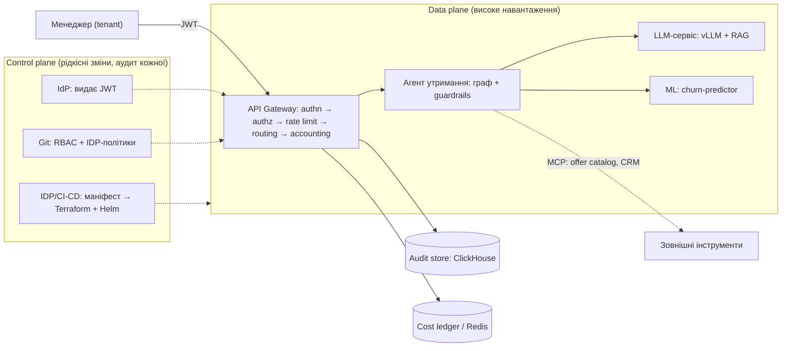

# Тема 14: що показувати на практиці і як це реалізувати

## 1. Головна ідея: показуємо те, чому присвячена тема

Слайд 4 прямо каже: Тема 14 *«не додає нових компонентів — вона визначає контракти платформи (автентифікація, квоти, аудит, витрати)»*.
Тож ціннісний «ефект» заняття — не в тому, що 7B-модель справді відповіла, а в тому, що студенти **бачать, як платформа поводиться**
навколо будь-якої моделі: кого впустила, кого відхилила, скільки це коштує, що записано в журнал і як це відтворити.

Звідси правило: **платформний шар — справжній, усе, що під ним, — заглушка з тим самим контрактом.**

| Компонент зі слайдів | У демо | Чому так |
|---|---|---|
| JWT RS256, RBAC, tenant із підписаного токена | **Справжнє** | Це предмет теми; працює без інфраструктури |
| Token bucket, бюджети, облік токенів → USD | **Справжнє** | Вмикається за секунди, видно 429 |
| Append-only аудит, `request_id`-trace, псевдонімізація клієнта | **Справжнє** (SQLite) | Інтерфейс як у ClickHouse; запити комплаєнсу працюють |
| Guardrail у коді + human approval | **Справжнє** | Ключовий меседж слайду 38 |
| Картка моделі + CI-gate, IDP-валідатор маніфестів | **Справжнє** | Дешево й дуже наочно (сл. 16–17, 24–25) |
| vLLM + AWQ | Заглушка; опційно будь-який OpenAI-сумісний бекенд (Ollama/OpenRouter) | GPU/завантаження моделі на занятті — ризик без користі |
| Векторна БД, reranking | Пошук за тегами в колекції орендаря | Ізоляція колекцій 1:1 показується й так |
| MLflow, Kubernetes, CI/CD, Grafana | **Не запускаємо**; показуємо як артефакти (`model_card.yaml`, `idp_requests/*.yaml`, `audit_report.py`) | Вони були в Т3–Т8; тут важливі лише контракти між ними |
| LangGraph, MCP-сервер | Той самий граф вузлів на Python; `ToolRegistry.call_tool` з інтерфейсом MCP | Без залежностей від версій |
| RAGAS, SHAP | Лексичний проксі; лінійні внески (coef×z) | Чесно позначено в коді та виводі |

## 2. Сценарій заняття (практична частина ≈ 70 хв + вправа 1)

| Час | Що робимо | Слайди | Команда / файл |
|---|---|---|---|
| 0–5 | Рамка: «що реальне, що заглушка і чому» (таблиця вище) | 40 | — |
| *до/паралельно* | **Вправа 1**: діаграма (30 хв, самостійно). Еталон — п. 5 | 41 | draw.io / Excalidraw |
| 5–25 | **Вправа 2, live-coding**: відкриваєте `security.py` → `gateway.py` і пояснюєте життєвий цикл; запускаєте сценарії 1–3 | 42–44, 12–15 | `python demo.py --pause` |
| 25–40 | **Вправа 3**: `audit.py` (хеш промпту, append-only тригери) → сценарій 8 → `audit_report.py` | 45, 26–27 | сценарій 8 |
| 40–55 | **Головне демо**: сценарій 4 (trace) і 5 (guardrail → схвалення) | 46–47, 37–38 | сценарії 4–5 |
| 55–63 | Rate limit (6) і бюджет (7): «платформа захищає від шумного сусіда й від рахунку» | 15, 17 | сценарії 6–7 |
| 63–68 | IDP: валідний і невалідний маніфест | 16–17 | `tools/idp_validate.py` |
| 68–75 | Зв'язок із продом + портфоліо (п. 6) | 48–49 | — |

**Про що говорити в кожному сценарії (одна фраза):**
1. 401 — «токен перевіряється публічним ключем; підробка і прострочення не відрізняються для клієнта».
2. 403 — «ролі → scope з YAML у Git; зміна політики = PR».
3. 404 для чужого клієнта і ігнорований `X-Tenant-Id` — «tenant береться лише з підписаного JWT; ми не розкриваємо, що ресурс існує».
4. Trace — «один `request_id` зв'язує ML → LLM → агент; це перше, що відкриє аудитор».
5. 25% > 15% — «guardrail — вузол у коді, модель його не обійде; operator не може схвалити сам».
6. 429 — «ліміт на орендаря, інші не страждають».
7. Алерт на 90%, блок на 4-му запиті — «`costCeiling` зі слайду 17 — не папірець».
8. «Усі рішення щодо клієнта X» і `DELETE` → відмова — «GDPR-запит і незмінність журналу».

## 3. Підготовка (за день до заняття)

```bash
pip install -r requirements.txt
python demo.py          # має закінчитися "невдало: 0"
```
Запасний варіант на випадок збою: заздалегідь запишіть екран із прогоном `python demo.py` (або збережіть вивід у файл: `python demo.py > run.txt`). Мережа для базового демо **не потрібна**.
Хочете «живу» модель: `ollama pull mistral:7b-instruct-q4_K_M`, далі змінні з README. Навіть якщо Ollama впаде — шлюз перейде на заглушку.

## 4. Що вже перевірено, а що ні

Перевірено запуском: усі 8 сценаріїв (33 перевірки), режими `--pause` і `--url`, fallback на заглушку при недоступному LLM-бекенді, обидва IDP-маніфести, CI-gate картки моделі.
**Не перевірено:** виклик справжнього провайдера LLM (у моїй пісочниці немає доступу до OpenRouter) — перед заняттям зробіть один тестовий прогін зі своїм ключем.
Латентності кроків у trace майже нульові (заглушки) — це чесно, а реальні мілісекунди з'являються при `LLM_BACKEND=openai`.

## 5. Еталон для Вправи 1 (діаграма)


Межі довіри для слайду 41: (1) інтернет → шлюз; (2) control plane → data plane (політики застосовуються на шлюзі); (3) агент → зовнішні MCP-інструменти.

## 6. Від демо до продакшну (для фінального слайду і портфоліо)

| Демо | У проді |
|---|---|
| SQLite + тригери | ClickHouse з обмеженими грантами або WORM-сховище |
| Ліміти/схвалення в пам'яті | Redis / БД (інакше не масштабується на кілька реплік) |
| Заглушка LLM | vLLM у K8s за HPA, `LLM_BACKEND=openai` на внутрішній endpoint |
| Лексичний `faithfulness_proxy` | RAGAS у CI та вибіркове оцінювання трафіку |
| `ToolRegistry` | MCP-сервери з власними правами |
| Ключі в `.keys/` | IdP (Keycloak/Entra), ротація ключів, JWKS |

Завдання для портфоліо з слайду 49 лишаються: репозиторій + діаграма + 3-хвилинний запис trace; поглиблення — підключити справжній ClickHouse або додати другий інструмент агента.

## 7. Помилки в слайдах, про які краще знати до live-coding

1. **Слайди 43–44: порядок middleware.** Я перевірив: якщо `AuthMiddleware` додано через `add_middleware`, а `rate_limit_mw` — декоратором `@app.middleware("http")` *після нього*, то rate-limit виконується **раніше** (останній доданий — зовнішній) і падає з `AttributeError: 'State' object has no attribute 'tenant_id'`. У репозиторії це розв'язано одним middleware з пронумерованими кроками.
2. **Слайд 44:** заголовок і слайд 15 кажуть «token bucket», а код — лічильник фіксованого вікна (`INCR` за хвилину): на межі вікон можливий удвічі більший сплеск. Справжній token bucket — `ratelimit.py`.
3. **Слайд 45 проти слайдів 26–27:** журнал на слайді 45 не містить `user_id`, `prompt_hash`, `decision`, які слайд 26 вважає обов'язковими.
4. **Слайд 43:** немає імпортів `Depends`, `JSONResponse`, `JWTError`; `require_scope` визначено лише на слайді 13 — студенти не зможуть скопіювати й запустити.
5. **Слайд 38:** у графі немає точки входу та ребра `draft_offer → guardrail_check`; `state` використовується і як словник (`{**state}`), і як об'єкт (`state.offer`).
6. **Слайд 17:** тег `vllm:0.6-approved` застарів (приклад, але студенти копіюють).
7. **Слайд 34:** за моїми відомостями, MLflow Model Registry stages (`transition_model_version_stage`) оголошені застарілими на користь aliases — перевірте за поточною документацією MLflow, бо це я у цій сесії не перевіряв.
8. **Слайд 49:** у списку інструментів є PostgreSQL, але ніде в практиці він не використовується.
9. Бібліотека JWT: на слайдах `python-jose`, у репозиторії `PyJWT` (його частіше радять у документації FastAPI); обидві працюють, API майже однакове.
