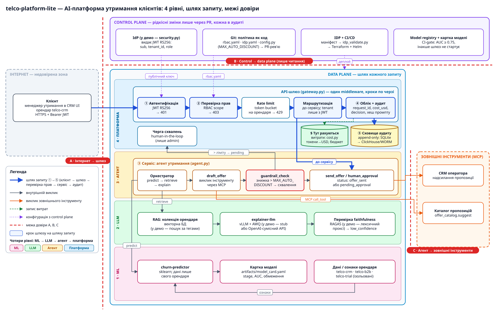

# Домашнє завдання — Тема 14, `telco-platform-lite`

Перевірено на Python 3.14: `pip install -r requirements.txt` → `python demo.py` → **33/33 перевірок успішно** (і до, і після змін).

| Завдання | Що здавати | Файли |
|---|---|---|
| 1. Діаграма | `diagram.png` | [`../diagram.png`](../diagram.png), джерело для draw.io: [`diagram/diagram.drawio`](diagram/diagram.drawio) (+ `diagram.svg`, генератор `build_diagram.py`) |
| 2. Роль auditor | diff політики + вивід 3 запитів | [`task2_rbac.diff`](task2_rbac.diff), [`task2_output.txt`](task2_output.txt), скрипт [`task2_auditor.sh`](task2_auditor.sh) |
| 3. Guardrail | diff `config.py` + trace | [`task3_config.diff`](task3_config.diff), [`task3_scenario4_after.txt`](task3_scenario4_after.txt), для порівняння [`task3_scenario4_before.txt`](task3_scenario4_before.txt), повний прогін [`task3_demo_full.txt`](task3_demo_full.txt) |
| 4. Рефлексія | текст | нижче |
| Бонус | `idp_validate.py` + 2 маніфести + вивід | [`bonus_idp.diff`](bonus_idp.diff), [`bonus_idp_output.txt`](bonus_idp_output.txt) |

---

## 1. Архітектурна діаграма



Як читати за хвилину:
- **Чотири рівні** — горизонтальні доріжки в data plane: 1 · ML (churn-predictor + картка моделі) → 2 · LLM (RAG орендаря + explainer-llm) → 3 · Агент (граф вузлів із guardrail) → 4 · Платформа (шлюз, облік, аудит).
- **Шлях запиту** (синя товста лінія): клієнт → ① шлюз (автентифікація JWT) → ② перевірка прав (RBAC) → rate limit → маршрутизація → ③ сервіс (агент) → ④ облік + аудит → ⑤ сховище аудиту.
- **Сховище аудиту** (жовтий циліндр, append-only) і **місце, де рахуються витрати** (зелений циліндр `$`, `cost.py`: токени → USD, бюджет орендаря).
- **Межі довіри** (червоні пунктири): **A** інтернет → шлюз; **B** control plane → data plane (шлюз лише читає публічний ключ і політики); **C** агент → зовнішні інструменти (MCP).

---

## 2. Роль `auditor`

```diff
   operator:
     ...
     - "agents:invoke"
+  auditor:                # комплаєнс: лише читання журналу аудиту (без моделей, агентів і білінгу)
+    - "audit:read"
   admin:
```

Токен: `security.issue_token("ivan@telco.com", "telco-crm", "auditor")`. Результат (`bash homework/task2_auditor.sh`, повний вивід у `task2_output.txt`):

```
── 1) auditor → GET /v1/audit/customers/C1224
   HTTP 200  [OK]
   {"customer_id":"C1224","events":[{"ts":"…","request_id":"req_a194bf5f","path":"/v1/models/churn-predictor/predict","status":200,"resource_name":"churn-predictor","decision":"score=0.987","cost_usd":0.0}]}

── 2) auditor → POST /v1/models/churn-predictor/predict
   HTTP 403  [OK]
   {"detail":"Role 'auditor' lacks scope 'models:invoke'"}

── 3) auditor → GET /v1/billing/usage
   HTTP 403  [OK]
   {"detail":"Role 'auditor' lacks scope 'billing:read'"}
```

Додатково видно, що журнал аудиту фіксує і відмови самого auditor-а (`decision = denied: role 'auditor' lacks 'models:invoke'`): аудитор теж підлягає аудиту.

---

## 3. Експеримент із guardrail

`platform_lite/config.py`: `MAX_AUTO_DISCOUNT = 15` → `10`. Сценарій 4 (клієнт зі score ≈ 0.75, пропозиція 12%):

```
POST /v1/agents/retention-agent/invoke → 200 ✅
     агент для клієнта C1200: status=pending_approval, offer=12% знижка лояльності + пріоритетна підтримка
…
  { "tier": "agent", "op": "draft_offer",     "discount_pct": 12 },
  { "tier": "agent", "op": "guardrail_check", "needs_approval": true, "limit_pct": 10 },
  { "tier": "agent", "op": "human_approval",  "result": "pending", "approval_id": "apr_327c63" }
```

До зміни (ліміт 15) той самий запит давав `needs_approval: false`, `limit_pct: 15` → `send_offer` / `status=offer_sent` (див. `task3_scenario4_before.txt`).

**Чому це зміна політики в коді (PR), а не в промпті.** Поріг перевіряє детермінований вузол `guardrail_check` у коді агента: модель лише пропонує знижку і не може ні переконати, ні обійти перевірку. Інструкцію в промпті LLM може проігнорувати, «забути» на довгому контексті або її можна обійти prompt injection. Ліміт у `config.py` змінюється лише через PR: є рецензент, історія в Git, можна відкотити, а CI проганяє демо як регресійний тест (усі 33 перевірки пройшли). Крім того, значення ліміту записується в trace (`limit_pct`), тому аудитор бачить, за якою саме версією політики ухвалено рішення, а з промптом так не вийде.

> Примітка: заголовок сценарію 5 у `demo.py` («знижка 25% > 15%») захардкоджений і після зміни трохи застарів. Логіка від цього не страждає: 25% > 10% теж іде на схвалення.

---

## 4. Рефлексія

У свій проєкт я переніс би насамперед три речі. Перша: один шлюз-middleware, де по черзі йдуть authn → authz → rate limit → облік → аудит, а `tenant_id` береться лише з підписаного JWT. Друга: RBAC і бізнес-ліміти як код у Git, бо тоді кожна зміна прав проходить рев'ю (роль `auditor` з цього завдання — це шість рядків YAML і один PR). Третя: наскрізний `request_id`-trace з guardrail-вузлом і human-in-the-loop, який одразу відповідає на питання «хто, що, за якою політикою і скільки це коштувало». Щоб піти в продакшн, довелося б замінити SQLite-аудит на ClickHouse з обмеженими грантами або WORM-сховище, а ліміти й чергу схвалень перенести з пам'яті процесу в Redis/БД, інакше вони не працюють на кількох репліках. Ключі з `.keys/` поступаються справжньому IdP (Keycloak/Entra) з ротацією та JWKS, а заглушка LLM — vLLM у Kubernetes за HPA. `ToolRegistry` треба замінити реальними MCP-серверами з власними правами, а лексичний `faithfulness_proxy` — RAGAS у CI та вибірковою оцінкою трафіку. IDP-валідатор маніфестів я б залишив майже як є, лише як обов'язковий крок CI перед Terraform/Helm, і поступово нарощував би його правилами, як `replicas.min ≥ 2` з бонусу.

---

## Бонус: правило IDP `replicas.min ≥ 2` для production

`policies/idp.yaml`: `allowed_environments: [dev, staging, production]`, `production_min_replicas: 2`.
`tools/idp_validate.py`: читає `metadata.environment`. Якщо поле не вказане, маніфест вважається **production** (fail-safe), тому правило не можна обійти, просто прибравши поле. Старі маніфести поводяться як раніше (✅ і 7 порушень).

```
$ python tools/idp_validate.py idp_requests/good-prod-churn-api.yaml
✅ good-prod-churn-api.yaml: політики пройдено — можна застосовувати через Terraform + Helm
$ python tools/idp_validate.py idp_requests/bad-prod-single-replica.yaml
❌ bad-prod-single-replica.yaml: 1 порушень політики
   • replicas.min=1 < 2 для production (одна репліка = простій під час оновлення чи збою вузла)
```
